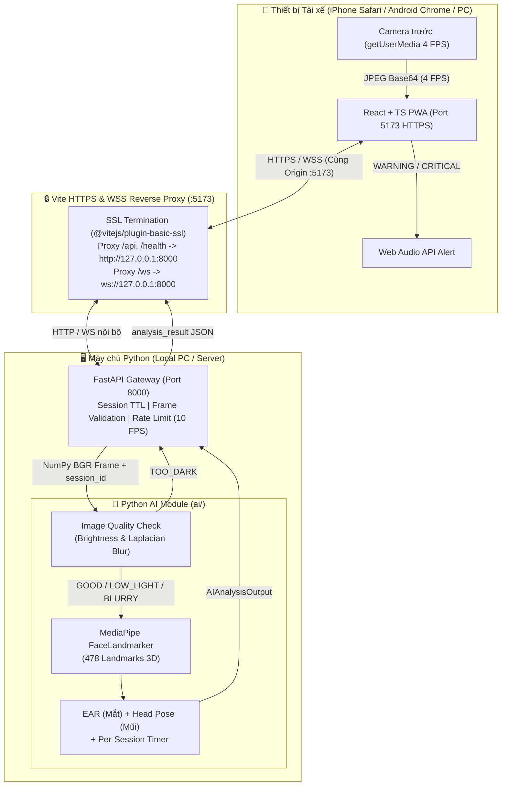

# PREDRIVE AI — PROJECT CONTEXT (TỔNG QUAN & TRẠNG THÁI HỆ THỐNG CẬP NHẬT)

> **Phiên bản:** 2.2 (Mobile App Android `.apk` + On-Device AI + Grab Minimal UI) | **Ngày cập nhật:** 08/11/2026  
> **Mới (v2.2):** **Đã hoàn thành Milestone M2.5** — triển khai giao diện phong cách Grab (`#00B14F`, font `Be Vietnam Pro`), linh vật **Vẹt xanh vẽ tay SVG (`ParrotMascot.tsx`)**, chuông báo kim loại (`useBellAlarm.ts`), **AI chạy trực tiếp trên thiết bị (`driverAnalyzer.ts` - MediaPipe WASM)** và đóng gói thành công file cài đặt Android **[`PreDrive-debug.apk`](file:///D:/CDIO4/PreDrive-debug.apk)** qua Capacitor — xem **Mục 9**.  
> **Trạng thái hiện tại:** Đã hoàn thành M1 (PWA ↔ FastAPI WebSocket), M2 (AI Baseline Python) và **M2.5 (Android Mobile App + On-Device AI độc lập không cần mạng LAN)**.
>
> **Nguồn thông tin chung cho cả ba thành viên và AI Coding Assistants (Codex / Antigravity).** Đọc file này trước, sau đó đọc `AI_CONTEXT.md`, `FRONTEND_CONTEXT.md`, `BACKEND_CONTEXT.md` và `docs/api-contract.md`.

---

## 1. Tầm nhìn và bài toán

**PREDRIVE AI** là nền tảng nghiên cứu giám sát dấu hiệu buồn ngủ và mất tập trung của người điều khiển **ô tô con, xe buýt/xe khách, xe tải, xe đầu kéo/container** (không nhắm tới xe máy). Điện thoại gắn cố định hướng camera về người lái; trình duyệt mở giao diện PWA và chủ động bắt đầu/kết thúc phiên giám sát. Dữ liệu hình ảnh được truyền đến máy chủ Python để phân tích. Khi phát hiện dấu hiệu cần chú ý, hệ thống phản hồi để PWA cảnh báo âm thanh và ghi sự kiện. Trong tương lai, quản trị viên có thể xem thống kê và nhận thông báo các sự kiện nghiêm trọng.

**Hai nhiệm vụ AI phải phân biệt rõ:**
1. **Detection hiện tại (MVP AI — Đã tích hợp Baseline v0.1):** phát hiện dấu hiệu quan sát được như mắt nhắm kéo dài (`EAR`), gật đầu/lệch hướng đầu (`Head Pose`), chất lượng ảnh (`Image Quality`).
2. **Early risk prediction (Nghiên cứu nâng cao — M6):** ước lượng nguy cơ suy giảm tỉnh táo trong một khoảng thời gian *tương lai*, chỉ triển khai sau khi có dữ liệu thời gian và nhãn tham chiếu đáng tin cậy. Không gọi EAR threshold là "dự đoán sớm".

---

## 2. Trạng thái hiện tại của Hệ thống (Đã hoàn thiện & Kiểm thử)

### 2.1. Cấu trúc thư mục thực tế tại Workspace (`d:\CDIO4`)

```text
d:\CDIO4\
├── ai/                             # [TV1 - AI Engineer] Module AI độc lập
│   ├── __init__.py                 # Export DriverMonitorAI, AIAnalysisOutput, Enums
│   ├── schemas.py                  # Pydantic schemas & Enums đồng bộ API Contract
│   ├── models/
│   │   └── face_landmarker.task    # Pretrained MediaPipe FaceLandmarker (478 3D landmarks)
│   ├── inference/
│   │   ├── __init__.py
│   │   ├── analyzer.py             # DriverMonitorAI: EAR, Head Pose, Per-session state timer
│   │   └── quality.py              # assess_image_quality: Luminance & Laplacian variance
│   ├── tests/
│   │   └── test_analyzer.py        # 4/4 Unit tests PASS (ảnh rỗng, ảnh tối, nhiễu, timing)
│   └── README.md                   # Tài liệu kỹ thuật module AI
│
├── backend/                        # [TV3 - Gia Huy] FastAPI WebSocket Gateway
│   ├── app/
│   │   ├── __init__.py
│   │   ├── main.py                 # REST (/health, /api/v1/sessions) + WS (/ws/monitor) + AI Hook
│   │   └── schemas.py              # FrameMessage, SessionResponse, AnalysisResult (Full Enums)
│   ├── tests/
│   │   └── test_gateway.py         # 8/8 Unit tests PASS (session, WS, rate-limit, AI response)
│   ├── requirements.txt
│   └── README.md
│
├── frontend/                       # [TV2 - Kenneth] React 19 + TS + Vite + Tailwind + Capacitor Android
│   ├── android/                    # Native Android project (Capacitor 8, MainActivity.java cấp quyền Camera)
│   ├── public/
│   │   ├── mediapipe/wasm/         # Bộ thực thi MediaPipe Vision WASM chạy offline trên thiết bị
│   │   └── models/
│   │       └── face_landmarker.task# Model FaceLandmarker đóng gói sẵn trong APK
│   ├── scripts/
│   │   └── copy-ai-assets.mjs      # Script tự động chép WASM + model vào public/ trước khi build
│   ├── src/
│   │   ├── ai/
│   │   │   └── driverAnalyzer.ts   # On-Device AI (port từ ai/inference/analyzer.py & quality.py)
│   │   ├── components/             # ParrotMascot.tsx (Vẹt xanh SVG) + các component buồng lái cũ
│   │   ├── config/
│   │   │   └── env.ts              # Tự động định tuyến qua Vite Proxy (HTTPS/WSS)
│   │   ├── features/
│   │   │   ├── driver/             # DriverScreen.tsx (UI Grab mới) & DriverMonitor.tsx (UI cũ)
│   │   │   └── admin/              # AdminStub.tsx (Stub cho Milestone 4)
│   │   ├── hooks/                  # useDriverAI, useBellAlarm, useWakeLock, useCamera (đổi cam trước/sau)
│   │   ├── services/               # api.ts (REST), monitorSocket.ts (WebSocket)
│   │   └── types/
│   │       └── monitor.ts          # Contract types & Enums
│   ├── capacitor.config.ts         # Cấu hình Capacitor (appId: com.predrive.ai, appName: PreDrive AI)
│   ├── vite.config.ts              # Cấu hình @vitejs/plugin-basic-ssl (HTTPS) + Proxy (/api, /ws, /health)
│   └── package.json
├── tools/                          # Bộ công cụ build Android độc lập (Corretto JDK 21 + Android SDK 36)
├── PreDrive-debug.apk              # File cài đặt Android hoàn chỉnh (~17.8 MB, chạy offline On-Device AI)
│
├── docs/
│   └── api-contract.md             # Tài liệu chuẩn hóa giao thức API Contract v0.1
├── venv/                           # Môi trường ảo Python 3.11.9 đã cài đủ thư viện
├── run_project.ps1                 # Script PowerShell khởi chạy tự động cả Backend + Frontend
├── PROJECT_CONTEXT.md              # File tổng quan hệ thống này
├── AI_CONTEXT.md                   # Context chi tiết cho TV1 (AI)
├── FRONTEND_CONTEXT.md             # Context chi tiết cho TV2 (Frontend)
└── BACKEND_CONTEXT.md              # Context chi tiết cho TV3 (Backend)
```

---

## 3. Kiến trúc Luồng Dữ liệu Thực tế (End-to-End Architecture)



### Giải pháp kỹ thuật quan trọng cho Điện thoại (Mobile HTTPS Proxy):
- Trình duyệt di động (đặc biệt là **Safari trên iOS**) bắt buộc trang web phải chạy trên **`https://` (Secure Context)** mới cấp quyền `navigator.mediaDevices.getUserMedia` (Camera).
- Nếu Frontend chạy `https://` nhưng gọi trực tiếp sang Backend `http://...:8000` hoặc `ws://...:8000`, trình duyệt sẽ chặn do lỗi **Mixed Content** hoặc lỗi chứng chỉ SSL trên cổng 8000.
- **Giải pháp đã triển khai:** Sử dụng `@vitejs/plugin-basic-ssl` tạo HTTPS ngay trên cổng `5173` và cấu hình **Vite Proxy** trong `frontend/vite.config.ts` chuyển tiếp toàn bộ `/api`, `/health`, và `/ws` về `127.0.0.1:8000`. Nhờ đó, điện thoại chỉ cần truy cập duy nhất `https://<IP-LAN>:5173` là vừa mở được Camera vừa kết nối WebSocket mượt mà.

---

## 4. Chi tiết kỹ thuật các Phân hệ

### 4.1. Phân hệ AI (`ai/`) — TV1
- **Model sử dụng:** `ai/models/face_landmarker.task` (MediaPipe FaceLandmarker).
- **Kiểm tra chất lượng ảnh (`ai/inference/quality.py`):**
  - Tính độ sáng trung bình (`mean_brightness`) trên ảnh xám:
    - `< 20.0` $\rightarrow$ `TOO_DARK` (Trả về ngay `MONITORING_UNAVAILABLE`, xóa timer, không đoán mò).
    - `< 45.0` $\rightarrow$ `LOW_LIGHT`.
  - Tính độ sắc nét bằng phương sai Laplacian (`cv2.Laplacian(gray, cv2.CV_64F).var()`):
    - `< 35.0` $\rightarrow$ `BLURRY`.
    - Còn lại $\rightarrow$ `GOOD`.
- **Phát hiện buồn ngủ & mất tập trung (`ai/inference/analyzer.py`):**
  - **Landmark mắt:**
    - Mắt trái: `[33, 160, 158, 133, 153, 144]`
    - Mắt phải: `[362, 385, 387, 263, 373, 380]`
  - **Công thức EAR (Eye Aspect Ratio):**
    $$\text{EAR} = \frac{\|p_1 - p_5\| + \|p_2 - p_4\|}{2.0 \times \|p_0 - p_3\|}$$
  - **Ngưỡng & Bộ đếm thời gian theo từng phiên (`SessionMonitorState`):**
    - Quản lý độc lập theo từng `session_id` (tự động dọn dẹp session không hoạt động sau 3600s).
    - **Ngưỡng nhắm mắt (`ear_threshold`):** `0.28`
      - Nhắm mắt liên tục $\ge 1.0\text{s}$ (`drowsy_warning_limit`): `state = "DROWSINESS_SIGNS"`, `alert_level = "WARNING"`, `risk_score = 0.80`.
      - Nhắm mắt liên tục $\ge 2.0\text{s}$ (`drowsy_critical_limit`): `state = "CRITICAL"`, `alert_level = "CRITICAL"`, `risk_score = 0.95`.
    - **Kiểm tra hướng đầu (`check_head_pose` qua mốc mũi `landmarks[1]`):**
      - Nếu đầu gục xuống thấp (`nose.y > 0.72`) hoặc quay ngang quá giới hạn (`nose.x < 0.30` hoặc `nose.x > 0.70`) liên tục $\ge 1.8\text{s}$ (`distracted_limit`): `state = "DISTRACTED"`, `alert_level = "WARNING"`, `risk_score = 0.65`.
    - **Bình thường:** `state = "NORMAL"`, `alert_level = "NONE"`, `risk_score = 0.10`.
    - **Mất dấu khuôn mặt:** `state = "MONITORING_UNAVAILABLE"`, `face_visible = False`, `alert_level = "NONE"`.
  - **Quyền riêng tư:** Đã loại bỏ hoàn toàn phần nhận diện danh tính khuôn mặt (`face_recognition` / `encodings.pickle`) khỏi luồng giám sát theo đúng nguyên tắc bảo mật sinh trắc học của dự án.

### 4.2. Phân hệ Backend Gateway (`backend/`) — TV3 (Gia Huy)
- **Endpoints:**
  - `GET /health`: Trả về `{"status": "ok", "service": "predrive-backend", "version": "0.1.0"}`.
  - `POST /api/v1/sessions`: Khởi tạo phiên mới, trả về `session_id` (UUID), `created_at`, `expires_at` (HTTP 201).
  - `WS /ws/monitor?session_id=<UUID>`: Nhận frame JSON base64, kiểm tra bảo mật & hợp lệ, gọi `ai_analyzer.analyze()` và trả về `AnalysisResult`.
- **Cơ chế bảo vệ & Ràng buộc an toàn:**
  - `MAX_FRAME_BYTES`: 2 MiB.
  - `MAX_IMAGE_WIDTH` x `MAX_IMAGE_HEIGHT`: 1920 x 1080.
  - `MAX_FPS`: 10 FPS (chống spam frame).
  - `MAX_FRAME_AGE`: 60s, `MAX_FUTURE_SKEW`: 60s (chống lệch múi giờ/đồng hồ giữa điện thoại và PC).
  - Kiểm tra `frame_id` tăng dần nghiêm ngặt; nếu frame lỗi thì trả `{"type": "error", "code": "INVALID_FRAME", "detail": "..."}` mà không làm sập kết nối WebSocket.

### 4.3. Phân hệ Frontend PWA (`frontend/`) — TV2 (Kenneth)
- **Tính năng đã hoàn thiện:**
  - Giao diện buồng lái ô tô (Automotive Cockpit Dark Mode) + Chế độ **Camera Focus Mode** toàn màn hình.
  - Quản lý vòng đời Camera an toàn (`useCamera.ts`), tự động phát hiện khi tab bị ẩn (`tab_hidden`) hoặc mất quyền camera (`camera_denied`, `insecure_context`).
  - Truyền frame định kỳ 4 FPS (`250ms`), nén JPEG (`quality: 0.65`, `maxWidth: 480px`).
  - Cảnh báo âm thanh đa mức độ bằng Web Audio API (`useAlertSound.ts`) kèm nút Mute.
  - Bảng chẩn đoán kỹ thuật (`DiagnosticsPanel.tsx`) hiển thị trực tiếp FPS thực tế, độ trễ khứ hồi (RTT ms), thời gian xử lý AI (`processing_ms`), chất lượng ảnh (`image_quality`) và `model_version` (`baseline-mediapipe-v0.1`).
  - Cơ chế Fallback: Chỉ khi Backend hoàn toàn tắt mới chuyển sang `Demo Mock (Offline)` (`mock-v0`).

---

## 5. Hợp đồng API (API Contract v0.1 — Đã đồng bộ 3 bên)

### Client → Server (WebSocket Frame)
```json
{
  "type": "frame",
  "session_id": "550e8400-e29b-41d4-a716-446655440000",
  "frame_id": 12,
  "captured_at": "2026-11-08T04:00:00.000Z",
  "image_format": "jpeg",
  "image_base64": "<base64-jpeg>"
}
```

### Server → Client (WebSocket Analysis Result)
```json
{
  "type": "analysis_result",
  "session_id": "550e8400-e29b-41d4-a716-446655440000",
  "frame_id": 12,
  "captured_at": "2026-11-08T04:00:00.000Z",
  "processed_at": "2026-11-08T04:00:00.038Z",
  "model_version": "baseline-mediapipe-v0.1",
  "state": "NORMAL",
  "alert_level": "NONE",
  "face_visible": true,
  "image_quality": "GOOD",
  "risk_score": 0.1,
  "processing_ms": 38
}
```

### Tập giá trị Enum chuẩn:
- `state`: `"NOT_EVALUATED" | "NORMAL" | "DISTRACTED" | "DROWSINESS_SIGNS" | "CRITICAL" | "MONITORING_UNAVAILABLE"`
- `alert_level`: `"NONE" | "INFO" | "WARNING" | "CRITICAL"`
- `image_quality`: `"GOOD" | "LOW_LIGHT" | "BLURRY" | "TOO_DARK" | "UNKNOWN"`
- `risk_score`: `null` hoặc số thực trong `[0.0, 1.0]`.

---

## 6. Hướng dẫn Khởi chạy & Kiểm thử

### 6.1. Khởi chạy toàn bộ hệ thống (1-Click)
Tại thư mục gốc `d:\CDIO4`, mở PowerShell và chạy:
```powershell
powershell -ExecutionPolicy Bypass -File .\run_project.ps1
```
Hoặc chạy thủ công trên 2 cửa sổ terminal:
- **Terminal 1 (Backend + AI):**
  ```powershell
  cd d:\CDIO4
  $env:PYTHONPATH = "d:\CDIO4"
  .\venv\Scripts\python.exe -m uvicorn backend.app.main:app --host 127.0.0.1 --port 8000 --reload
  ```
- **Terminal 2 (Frontend HTTPS):**
  ```powershell
  cd d:\CDIO4\frontend
  npm run dev
  ```

### 6.2. Truy cập trên Máy tính & Điện thoại
- **Trên máy tính (PC):** Mở trình duyệt vào `https://localhost:5173/`
- **Trên điện thoại (cùng mạng Wi-Fi/LAN):**
  1. Mở Safari (iPhone) hoặc Chrome (Android), nhập `https://<IP-MÁY-TÍNH>:5173/` (ví dụ: `https://192.168.0.106:5173/`).
  2. Bỏ qua cảnh báo chứng chỉ tự ký: Nhấn **Hiển thị chi tiết (Advanced)** $\rightarrow$ **Tiếp tục truy cập trang web (Proceed)**.
  3. Nhấn **BẮT ĐẦU GIÁM SÁT** $\rightarrow$ Cho phép quyền **Camera**.
  4. Kiểm tra góc trên bên trái hiện **`Server: Đã kết nối`** (chấm xanh lá) và `Model ID: baseline-mediapipe-v0.1`.

### 6.3. Chạy Bộ Kiểm thử Tự động (Automated Tests)
```powershell
cd d:\CDIO4
$env:PYTHONPATH = "d:\CDIO4;d:\CDIO4\backend"
.\venv\Scripts\python.exe -m pytest ai/tests backend/tests -v
```
- `ai/tests/test_analyzer.py`: **4/4 PASSED**
- `backend/tests/test_gateway.py`: **8/8 PASSED**

---

## 7. Lộ trình Tiếp theo (Milestones M3 → M6)

| Milestone | Nội dung công việc | Trạng thái |
|---|---|---|
| **M1: Camera PWA ↔ FastAPI** | Quyền camera, HTTPS proxy, session, truyền frame WS, đo latency, xử lý mất kết nối. | ✅ **HOÀN THÀNH** |
| **M2: AI Baseline** | Tích hợp MediaPipe FaceLandmarker, tính EAR, Head Pose, đánh giá chất lượng ảnh, cảnh báo thời gian thực. | ✅ **HOÀN THÀNH** |
| **M3: Database & Auth** | Lưu trữ PostgreSQL/SQLite (`users`, `drivers`, `trips`, `events`, `alerts`), xác thực JWT/Session. | ⏳ Chuẩn bị triển khai |
| **M4: Admin Dashboard & Telegram** | Giao diện thống kê chuyến đi/sự kiện bằng Recharts, gửi cảnh báo nghiêm trọng qua Telegram Bot. | ⏳ Kế hoạch |
| **M5: Low-light Research** | Thực nghiệm so sánh `Original vs CLAHE vs Zero-DCE++` trên tập dữ liệu thiếu sáng, đo FPS/Recall. | ⏳ Kế hoạch |
| **M6: Early Prediction & Evaluation** | Đánh giá định lượng trên NTHU-DDD / RLDD và thử nghiệm mô hình chuỗi thời gian (GRU/TCN). | ⏳ Kế hoạch |
| **M2.5: Mobile App (Android) + On-Device AI + UI mới** | Đóng gói `frontend/` thành app Android (Capacitor), chạy MediaPipe trực tiếp trên điện thoại, giao diện tối giản phong cách Grab có mascot Vẹt xanh (xem Mục 9). | ✅ **HOÀN THÀNH (`PreDrive-debug.apk`)** |

---

## 8. Quy tắc An toàn & Làm việc Nhóm

1. **Phân vùng mã nguồn:** TV1 phụ trách `ai/`, TV2 phụ trách `frontend/`, TV3 phụ trách `backend/` và `database/`. Mọi thay đổi lên API Contract phải cập nhật vào `docs/api-contract.md`.
2. **Minh bạch mô hình:** Luôn gắn `model_version` rõ ràng (`baseline-mediapipe-v0.1` cho AI thật và `mock-v0` khi chạy offline). Không bao giờ báo `NORMAL` khi mất mạng, mất khuôn mặt hoặc ảnh quá tối (`TOO_DARK` $\rightarrow$ `MONITORING_UNAVAILABLE`).
3. **Bảo mật & Quyền riêng tư:** Không lưu video khuôn mặt thô mặc định trên server; không commit `.env`, token, hoặc dữ liệu cá nhân lên Git.

---

## 9. Định hướng mới: Mobile App + Giao diện Mascot (Cập nhật 08/11/2026)

> **Trạng thái:** **ĐÃ TRIỂN KHAI HOÀN TẤT & XUẤT FILE `PreDrive-debug.apk`.** Toàn bộ mã nguồn giao diện mới, chú vẹt xanh SVG, chuông báo kim loại, On-Device AI (`@mediapipe/tasks-vision`) và project Android Capacitor đã được tích hợp vào `frontend/`.

### 9.1. Vấn đề phát hiện khi test thực tế
- Truy cập `https://<IP-LAN>:5173` từ điện thoại **chỉ chạy được khi điện thoại và PC cùng mạng Wi-Fi/LAN** (IP `192.168.x.x` là IP nội bộ). Dùng 4G/5G hoặc Wi-Fi khác sẽ không kết nối được.
- Safari iOS hay gặp lỗi: gõ thiếu `https://`, kẹt ở màn hình cảnh báo chứng chỉ tự ký, hoặc Windows Firewall chặn cổng `5173`.
- Giải pháp triệt để đã triển khai: đóng gói thành **App Android độc lập (`.apk`)** tích hợp sẵn **On-Device AI** chạy trực tiếp trên điện thoại mà không cần mạng LAN hay máy chủ Python.

### 9.2. Quyết định kiến trúc (Đã triển khai)
| Hạng mục | Quyết định & File triển khai |
|---|---|
| Nền tảng | **Android** (`minSdkVersion = 24`, `compileSdkVersion = 36`, `targetSdkVersion = 36`). File cài đặt xuất ra tại `D:\CDIO4\PreDrive-debug.apk` (~17.8 MB). |
| Cách đóng gói | **Capacitor 8 (`@capacitor/core`, `@capacitor/android`)** bọc code React + TS trong `frontend/android/`. Tự động xin quyền `android.permission.CAMERA` và cấp quyền `WebChromeClient.onPermissionRequest` trong `MainActivity.java`. |
| Vị trí chạy AI | **Phương án 2 – On-Device AI (`frontend/src/ai/driverAnalyzer.ts` & `useDriverAI.ts`):** chạy MediaPipe FaceLandmarker (`@mediapipe/tasks-vision` WASM + `face_landmarker.task` trong `public/`) ngay trên điện thoại ở tần suất 10 FPS (`100ms`), giữ nguyên ngưỡng EAR (`0.28`), thời gian cảnh báo (`1.0s` / `2.0s`), hướng đầu (`1.8s`) và kiểm tra độ sáng (`TOO_DARK < 20`, `LOW_LIGHT < 45`) của `ai/inference/`. |
| Vai trò Backend | Giữ nguyên FastAPI (`backend/`); dùng để đồng bộ phiên/sự kiện khi có mạng (phục vụ M3/M4). |

### 9.3. Giao diện & Trải nghiệm đã triển khai (`DriverScreen.tsx`)
- **Tối giản tuyệt đối, chỉ tập trung cảnh báo buồn ngủ:**
  - Camera **toàn màn hình** (`100dvh`), tự động lật gương khi dùng camera trước (`facing === 'user'`) và giữ nguyên chiều khi đổi sang camera sau (`environment`).
  - Cụm 3 nút điều khiển ở đáy màn hình (thẻ trắng bo tròn kiểu Grab): `Âm thanh` (bật/tắt tiếng chuông) – `Bắt đầu / Dừng giám sát` (nút lớn màu xanh Grab `#00B14F`, cao 56px) – `Đổi cam` (chuyển camera trước/sau kèm hiệu ứng lật mượt mà trong `useCamera.ts`).
  - Giữ màn hình luôn sáng khi đang giám sát bằng Screen Wake Lock API (`useWakeLock.ts`).
  - **Không hiển thị** EAR, hướng đầu, biểu đồ hay thông số kỹ thuật gây rối mắt tài xế.
- **Mascot riêng: Vẹt xanh phụ xe (`frontend/src/components/ParrotMascot.tsx`):**
  - Phong cách **vẽ tay bằng SVG, nét viền xanh đậm `#064E2B`, phẳng**.
  - **Dáng vẹt thật:** đậu nghiêng nhìn sang trái, **mỏ cam khoằm to**, mảng đỏ trên trán, mảng trắng quanh mắt, chỏm lông vuốt ra sau, cánh gập có vân xanh lam, đuôi dài rủ xuống.
  - Thẻ thông báo đặt ngay dưới viên trạng thái ở trên cùng, **không che mặt tài xế**.
  - Bảng màu vẹt bám theo giao diện: thân xanh Grab `#00B14F`, cánh `#00804A`, bụng `#B8F0CE`, đuôi xanh lam `#0A8F9E`, mỏ cam `#F5A623`, mảng trắng quanh mắt.
  - `NORMAL` (`mood = 'peek'`): vẹt **núp ở mép phải**, chỉ ló nhẹ và chớp mắt tự nhiên, không che camera.
  - `DISTRACTED` / `DROWSINESS_SIGNS` (`mood = 'warn'`): vẹt **thò đầu ra**, mắt lim dim nhíu mày, thẻ thông báo *"Chíu chíu! Hơi lim dim rồi đó"* hoặc *"Chíu chíu! Nhìn thẳng đường nhé"*.
  - `CRITICAL` (`mood = 'alarm'`): giao diện chuyển **báo động đỏ** (viên trạng thái đỏ, viền màn hình chớp đỏ, nút chính đỏ, thẻ *"Dậy đi bác tài ơi!"*), vẹt **chỉ thò đầu ra nhẹ như lúc lim dim** (không nhảy ra, không xoè cánh), mắt mở to viền đỏ, rung nhẹ (`bell-shake`), kèm **tiếng reng chuông** lặp lại.
  - `MONITORING_UNAVAILABLE` / chưa giám sát: vẹt lùi vào trong mép phải, mờ đi (`opacity-50`).
- **Âm thanh cảnh báo (`frontend/src/hooks/useBellAlarm.ts`):** tiếng reng chuông kim loại tổng hợp bằng Web Audio API (3 hồi *"reng-reng-reng"*, lặp mỗi 1,5 giây) khi `CRITICAL`; mức `WARNING` chỉ nhắc bằng hình ảnh.
- **Màu sắc & font (`frontend/src/index.css`):** màu chính **xanh Grab `#00B14F`** (nhấn `#009A44`, nền nhạt `#E5F7ED`), chữ đen `#1C1C1C` / xám `#5E6366`, viền `#E8E8E8`, nhắc nhở cam `#F5A623`, nguy hiểm đỏ `#E5372B`. Font **`Be Vietnam Pro`** cài offline qua `@fontsource/be-vietnam-pro` (400/500/600/700).

### 9.4. Hướng dẫn Build lại file `.apk` khi sửa code Frontend
Bộ công cụ JDK 21 (Amazon Corretto 21) và Android SDK 36 đã được cài đặt sẵn tại `D:\CDIO4\tools` (không làm ảnh hưởng biến môi trường hệ thống). Khi cần build lại `.apk`, mở PowerShell chạy:
```powershell
$env:JAVA_HOME = "D:\CDIO4\tools\jdk21\jdk21.0.13_0"
$env:ANDROID_HOME = "D:\CDIO4\tools\android-sdk"
$env:GRADLE_USER_HOME = "D:\CDIO4\tools\gradle-home"

cd D:\CDIO4\frontend
node scripts/copy-ai-assets.mjs
npm run build
npx cap sync android

cd D:\CDIO4\frontend\android
.\gradlew.bat assembleDebug --no-daemon
Copy-Item "D:\CDIO4\frontend\android\app\build\outputs\apk\debug\app-debug.apk" "D:\CDIO4\PreDrive-debug.apk" -Force
```

### 9.5. Trạng thái các bước triển khai Mobile App (M2.5)
1. ✅ Người dùng duyệt bản preview Vẹt xanh núp mép phải (`predrive_ui_concepts.html`).
2. ✅ Tách mascot thành component React (`frontend/src/components/ParrotMascot.tsx`) + tạo chuông báo kim loại (`frontend/src/hooks/useBellAlarm.ts`).
3. ✅ Viết màn hình giám sát tối giản kiểu Grab (`frontend/src/features/driver/DriverScreen.tsx`) + hỗ trợ đổi camera trước/sau (`useCamera.ts`) + giữ sáng màn hình (`useWakeLock.ts`).
4. ✅ Tích hợp `@mediapipe/tasks-vision` chạy AI trực tiếp trên thiết bị (`frontend/src/ai/driverAnalyzer.ts` & `useDriverAI.ts`).
5. ✅ Thêm Capacitor + `@capacitor/android`, cấu hình quyền `CAMERA` trong `AndroidManifest.xml` & `MainActivity.java`, xuất thành công file `D:\CDIO4\PreDrive-debug.apk`.
6. ✅ Cập nhật `PROJECT_CONTEXT.md` và `FRONTEND_CONTEXT.md`.
